# PITH — practical persistent homology on CPUs

PITH computes **persistent homology** of a point cloud: which components,
loops, and voids appear and disappear as you thicken the cloud.

It is a **CPU tool**, not a GPU rewrite of Ripser. The gain comes from
choosing the right exact engine, avoiding a dense distance matrix when
the cloud is sparse, and — when exact Vietoris–Rips is no longer
practical — switching to a smaller Euclidean complex and saying so.

We did **not** invent a faster worst-case VR algorithm for every graph.
We **did** make everyday low-dimensional clouds usable at sizes where
stock VR engines time out.

Details: [`docs/WHAT_WE_BUILT.md`](docs/WHAT_WE_BUILT.md),
[`docs/SCALE_PATH.md`](docs/SCALE_PATH.md),
[`docs/COMPLEXITY.md`](docs/COMPLEXITY.md),
[`docs/PRACTICAL_LIMITS.md`](docs/PRACTICAL_LIMITS.md),
[`docs/REMAINING.md`](docs/REMAINING.md).
Dashboard: [PITH consolidation results](https://cursor.com/canvas/store-bfb92e22-33cb-473f-b3c3-3bfc05d5722d/8a09a96a-dbf1-4b70-96ec-8021bc123ce6).

## What is this?

A **portfolio**: two exact VR engines, a small dispatcher that picks
between them, sparse graph representations when the threshold graph is
hollow, exact \(H_0\) on the 2D/3D Delaunay skeleton, and an optional
**different** Euclidean complex when exact VR becomes impractical.

## What did we improve?

| Kind | What |
| --- | --- |
| Exact VR, same barcode as Ripser | An **automatic engine**: collapse + implicit cohomology when the residual is thin; RedZeD (active enumeration) when it is not. Sparse \(G_T\) when the cloud is hollow. |
| Exact \(H_0\) in 2D/3D | Kruskal on the Delaunay 1-skeleton (the MST sits inside Delaunay). \(\Theta(n)\) edges instead of all pairs. |
| Large Euclidean clouds | `--mode scale`: flag of a Delaunay / local-radius graph. **Not** Vietoris–Rips. Essential loops and voids are kept on the tested families; finite bars differ. |
| Feasibility | `--estimate` guesses graph size, residual regime, `wall_kind` (collapse vs leftover vs construction), and whether exact VR is reasonable (`auto_will_run` is false when the recommended path is known to hang). Runtime lo/hi bands cover **48/48** scored recommended-mode walls (`eval_estimate.py`, includes leftover-miss n-series). `wall_kind` matches measured collapse vs leftover share **20/20**. `--mode auto` follows that probe (default stays `--mode exact` so scripts do not silently change complex). |
| Fair timing | `--threads N` caps workers. Measured 1-thread vs hardware vs Ripser (always 1 thread). |

Internal experiment numbers live in [`RESEARCH_LOG.md`](RESEARCH_LOG.md),
not in the user interface.

## Is it exact?

**`--mode exact` (default)** is exact Vietoris–Rips up to the threshold \(T\).
On the hold suite the barcode matches Ripser (0 unmatched bars), including
a non-Euclidean L1 distance matrix.

**`--mode scale`** is a **different complex** (Delaunay-flag, optional
thicken). Compare essential Betti numbers and unmatched finite bars;
do not treat the diagram as VR.

**`--mode sparse`** is a Sheehy-style sparse Rips approximation (ε=0.6).
It **does** thin the flag (figure-8 \(n=400\): 5.6k edges vs 80k pairs;
\(n=8000\): 380k vs 32M). Euclidean point clouds no longer allocate an
n×n distance matrix; farthest-point insertion is still \(\Theta(n^2)\).
figure-8 \(n=8000\) is **0.65 s / 28 MB**; \(n=24000\) is **5.56 s / 101 MB /
ess \(H_1=2\)** (local \(p\approx 1.9\)–\(2.0\), the FPS wall). Scale on
the same \(n=24000\) cloud is **0.82 s**. Essential \(H_1\) is usually
kept; finite bars differ. Measured sparse vs Ripser at \(n=400\):
figure-8 / circle bottleneck \(H_1\approx 0.006\)–\(0.007\),
\(W_1\approx 0.023\)–\(0.034\); `nested_loops` keeps ess \(H_1=1\) but
\(W_1(H_1)\approx 1.05\) (52 unmatched). Some seeds of `nested_loops`
can add extra essential loops (4 vs VR 1). \(H_2\) is
slow (two spheres \(n=300\): 3.7 s) or times out (sphere \(n=400\);
4D fat \(H_2\)). Prefer `--mode scale` on Euclidean \(d\in\{2,3\}\).
`--mode auto` selects sparse on a held-out 4D cloud when exact VR is
marked impractical **and `maxdim=1`**. Fat \(H_2\) on \(d\notin\{2,3\}\)
is **refused** (exit 3) instead of started — that path timed out at
25 s on `uniform4` \(n=250\). Pass `--mode sparse` explicitly if you
still want it, or drop to `--maxdim 1`.

GUDHI **Alpha** is a third complex: on this suite it **drops** essential
\(H_1/H_2\) (loops and voids become 0). We do not use it as a VR stand-in.

## How to run

```sh
cmake -S src/pith -B src/pith/build -DCMAKE_CXX_COMPILER=g++
cmake --build src/pith/build -j
./src/pith/build/pith_test
```

```sh
# Exact VR (automatic engine)
./src/pith/build/pith --points cloud.csv --maxdim 1 --threshold 1.1

# Force one exact engine (benchmarking)
./src/pith/build/pith --points cloud.csv --mode exact --engine redzed --maxdim 1 --threshold 1.1

# Equal-thread comparison with Ripser
./src/pith/build/pith --points cloud.csv --threads 1 --mode exact --maxdim 1 --threshold 1.1

# Euclidean scale path (d = 2 or 3 only; not exact VR)
./src/pith/build/pith --points cloud.csv --mode scale --maxdim 1 --threshold 1.1
./src/pith/build/pith --points cloud.csv --mode scale --maxdim 2 --threshold 1.4

# Feasibility guess (no persistence)
./src/pith/build/pith --estimate --points cloud.csv --maxdim 1 --threshold 1.1 --format json

# Follow the probe: exact if feasible, else scale (d=2,3) or sparse
./src/pith/build/pith --points cloud.csv --mode auto --maxdim 2 --threshold 1.4
```

`--help` is the stable interface. `--help-experimental` lists research
flags kept for old scripts.

## When should I use each mode?

| Situation | Mode |
| --- | --- |
| You need the VR barcode (including finite bars) | `--mode exact` |
| You want the probe to choose exact / scale / sparse | `--mode auto` |
| Euclidean \(d\in\{2,3\}\), \(n\) in the tens of thousands, essential loops/voids | `--mode scale` |
| You only need \(H_0\) in 2D/3D | `--mode exact --maxdim 0` (Delaunay Kruskal) |
| Abstract / non-Euclidean distances | `--distances FILE --mode exact` |
| Fat residual and `maxdim≥2` on a **large** connected component (\(n_{cc}\gtrsim 800\)) | `--mode scale` if \(d\in\{2,3\}\); else lower \(T\) or `--maxdim 1` |
| Mixed 1D/2D/3D, a few hundred points, `maxdim=2` | `--mode exact` (RedZeD-cc); scale if you only need essential bars |
| Exact VR looks infeasible and \(d\ge 4\), \(H_1\) only | `--mode sparse` or a smaller \(T\); do not use scale |
| Fat \(H_2\) and \(d\ge 4\) | `--mode auto` refuses (exit 3). Use `--maxdim 1` or explicit `--mode sparse` |
| High-d \(H_1\) (\(d\ge 4\)) | `--mode exact` or `--mode auto` (auto stays exact unless sparse is clearly cheaper) |

## How much larger can it go?

On **this** hardware (4 CPUs, 16 GB, no GPU), under a **12 s** wall budget.
1-thread PITH vs 1-thread Ripser unless noted.

| Task | Ripser | giotto-ph t1 | giotto-ph t4 | GUDHI Rips | Dory 1-thr | PITH exact (1 thr) | PITH scale |
| --- | --- | --- | --- | --- | --- | ---: | --- |
| Noisy circle \(H_1\), \(n=1000\) | 2.16 s | 2.47 s | 2.44 s | timeout | 2.79 s | **0.068 s (32× / 36× giotto)** | not needed |
| Noisy circle \(H_1\), \(n=2000\) | timeout | — | — | — | timeout | 0.35 s (paired) | not needed |
| Figure-8 \(H_1\), \(n=2000\) | 2.51 s | 2.81 s | 2.78 s | timeout | 2.84 s | **0.152 s (16×)** | 34 ms, ess \(H_1=2\) |
| Figure-8 \(H_1\), \(n=4000\) | timeout | — | — | — | timeout | **1.03 s** (paired limit 3.66 s) | 0.09 s, ess \(H_1=2\) |
| Figure-8 \(H_1\), \(n=24000\) | impractical | — | — | — | — | leftover wall | **0.79 s**, ess \(H_1=2\) |
| Sphere \(H_2\), \(n=400\) | 1.02 s | 1.12 s | 0.62 s | timeout | 4.13 s | **0.017 s (60×; 36× vs giotto-4)** | 7 ms, ess \(H_2=1\) |
| Sphere \(H_2\), \(n=800\) | timeout | — | — | — | timeout by \(n=600\) | **0.057 s** | small |
| Sphere, \(n=80000\) | impractical | — | — | — | — | impractical as dense VR | **1.08 s**, ess \(H_2=1\) |
| Nested loops \(H_1\), \(n=2000\) | 6.44 s | — | — | — | — | **0.29 s** | 0.036 s |
| Blobs \(H_0\), \(n=25000\) | tens of seconds | — | — | — | — | **0.053 s** (Delaunay) | n/a |
| Mixed 1D/2D/3D, \(n=300\), `maxdim=2` | 0.14 s | — | — | — | — | **0.033 s (4×)** | **5 ms** |
| Mixed 1D/2D/3D, \(n=1000\), `maxdim=2` | 7.25 s | — | — | — | — | **1.07 s (6.8×)** | **19 ms** |
| Mixed 1D/2D/3D, \(n=2000\), `maxdim=2` | timeout (15 s) | — | — | — | — | 13.6 s (leaves a 12 s budget) | **51 ms** |
| Uniform \(d=10\) \(H_1\), \(n=1600\) | 2.37 s | — | — | — | — | **0.13 s** | n/a (no scale) |
| Uniform \(d=10\) \(H_1\), \(n=4000\) | timeout | — | — | — | — | **0.65 s** (auto now exact, 0.74 s) | n/a |

The headline exact ratios **hold at 1 thread**, and they still hold against
**4-thread giotto-ph**. A live re-measure on this box: circle \(n=1000\)
**31.2×** (0.070 vs 2.17 s); sphere \(n=400\) **58.3×** (0.018 vs 1.02 s).
On the circle the wall is **collapse** (46 ms of 68 ms), not pairing
(1 ms). On figure-8 \(n=2000\) the wall is **reduce** (95 ms of 147 ms).
Live leftover-family 1-thread ratios vs Ripser: figure-8 **17.0×**, torus
**12.6×**, blobs **12.9×**, sphere H1 **8.5×**, uniform2 n=5000 **8.1×**
(3/6 ≥10× at those sizes — not a general 10×). Held-out leftover
families (`leftover_heldout.json`, seed 19): **4/7 ≥10×** after
dropping collapse walls; misses include anisotropic 5.5× and
grid_holes 3.2×. Growing those misses (`leftover_miss_n.json`)
does **not** produce a 10×: anisotropic 5.3→8.8→6.6× (recedes
when the representation flips; Ripser 12.1 s at \(n=8000\)),
grid_holes 3.0→6.1×, **0/7 ≥10×**. `--mode auto` stays exact on
those \(n=8000\) leftover cells; hollow figure-8 \(n=16000\) still
selects scale. Along n
(`leftover_ratio_n.json`): sphere H1 crosses 10× near \(n=4000\)
(**11.4×**); uniform2 is still **9.1×** at \(n=7000\); figure8
plateaus ~16× once both engines explode.
**Dory** (`pydory` 1.1.137, 1 thread, not vendored) **tracks Ripser** on
those leftover \(H_1\) cells (figure-8 \(n=2000\) 2.84 vs 2.72 s; circle
\(n=1000\) 2.79 vs 2.73 s) and is **slower** on sphere \(H_2\) \(n=400\)
(4.13 vs 1.49 s). 12 s first-fail (`dory_limits.json`): last OK circle
\(n=1500\) 9.45 s / figure-8 \(n=3000\) 5.70 s; both timeout at the same
next \(n\) as Ripser; sphere \(H_2\) times out at \(n=600\) while Ripser
still finishes (5.3 s). PITH exact is \(16\)–\(39\times\) faster than
Dory on the leftover cells. Same pairing class; not a 10× engine.
**Oineus** (`oineus` 0.9.39, 1 thread, not vendored) is **slower than
Ripser** on leftover \(H_1\) (circle \(n=400\) 1.54 vs 0.13 s; figure-8
\(n=1000\) 4.68 vs 0.61 s; torus \(n=1000\) 4.27 vs 0.40 s) and times
out at 20 s where Ripser still finishes (circle \(n=1000\), figure-8
\(n=2000\), sphere \(H_2\) \(n=400\)). Lock-free reduction + in-order
VR generation; the published win is multi-core. giotto-ph is that
family already timed at 4 threads on \(H_1\) (no win). Not a 10× engine.
**Dionysus 2.2.3** (1 thread, not vendored) is explicit `fill_rips`:
circle \(n=400\) **11.68 s / 2.38M simplices** vs Ripser 0.18 s
(**65× slower**). The other leftover cells timeout at 20 s while
Ripser still finishes. Same class as GUDHI Rips; not a 10× engine.
**Coperto** 0.1.7 (Leitão arXiv:2602.22784) is a quotient-cover
**approximation** (claimed log-3 interleaving), not exact VR. With
`greedy=False`, figure-8 \(n=8000\) is 6.74 s vs scale 0.21 s; essential
loops become finite (figure-8 / circle ess \(H_1=0\) vs VR 2 / 1).
The library default `greedy=True` drops all \(H_1\). Not a 10× engine.
Hardware threads (4) change circle \(n=1000\) from 0.068 s to 0.069 s —
not the source of the 32×. giotto-ph’s 4 threads help sphere \(H_2\)
(1.12→0.62 s) and do **not** speed up \(H_1\).

Pushed to the 12 s wall: circle \(n=2000\) PITH **0.34 s**, Ripser and
giotto timeout; figure-8 \(n=4000\) PITH **1.02 s**, giotto timeout;
sphere \(n=800\) PITH **0.058 s**, giotto timeout; nested loops \(n=2000\)
PITH **0.30 s** vs giotto **7.23 s** (24×).

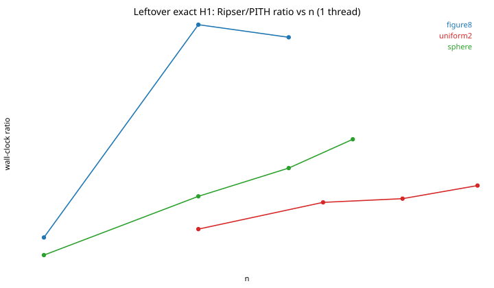

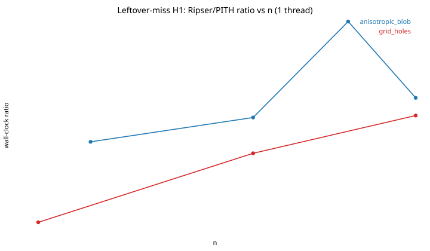

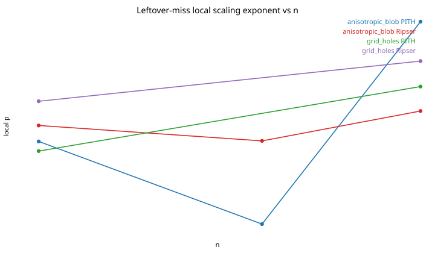


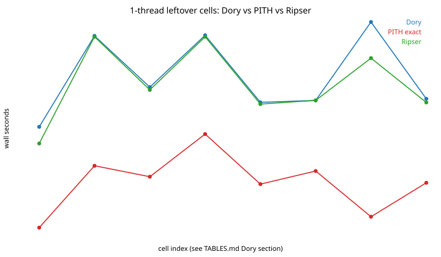

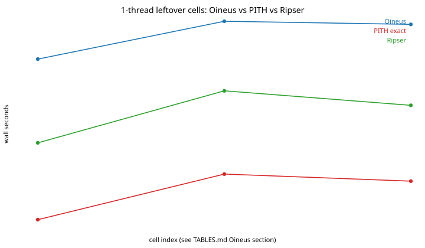

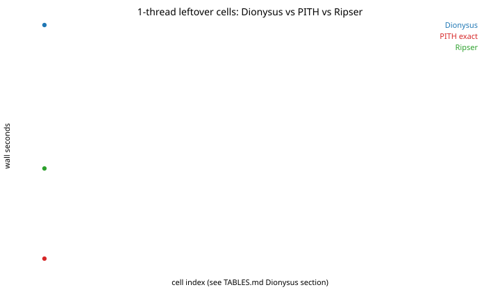

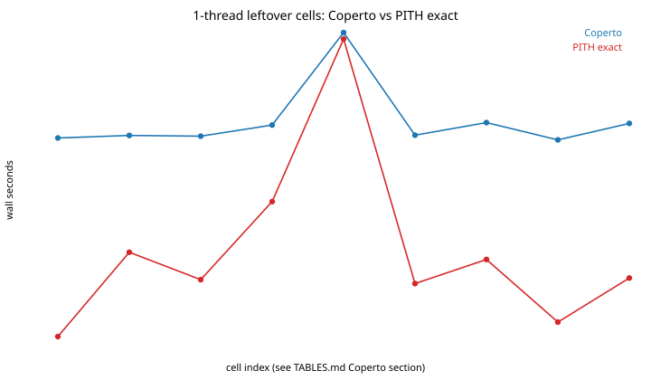

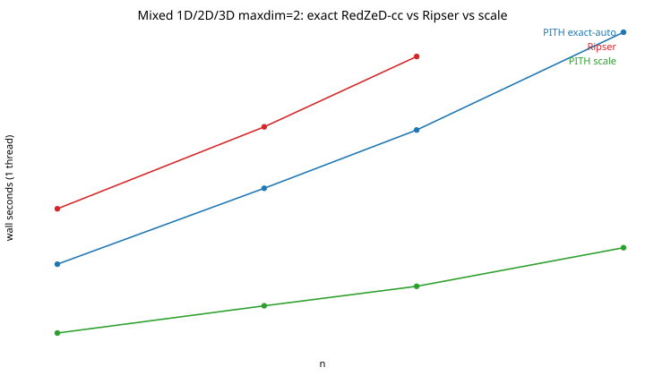


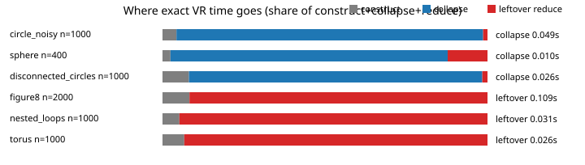


Local time exponents (empirical, not theorems): scale stays \(p\approx 1.0\)–\(1.3\);
exact figure-8 / nested-loop \(H_1\) leaves that regime around a few thousand
points (\(p\approx 2.8\)–\(3.0\)); Ripser on the same series is \(p\approx 2.7\)–\(3.5\).

Axis sweeps at **1 thread** (`axis_scaling.json`): raising \(T\) on a
circle \(n=400\) sends Ripser \(0.007\to 0.26\) s and GUDHI
\(0.037\to 3.2\) s (\(p_T\) up to 5.4 — explicit simplex tree). PITH
exact stays \(0.004\to 0.023\) s; scale stays 4–6 ms. More noise makes
exact VR *cheaper* (the loop washes out). At fixed \(T\), higher ambient
dimension is *sparser*, not harder. GUDHI is the first method to fail
the 8 s budget (uniform2 \(n=800\), \(T=0.55\)).

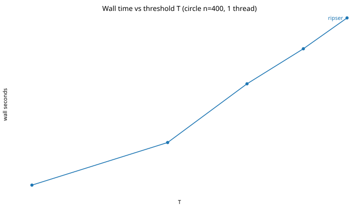

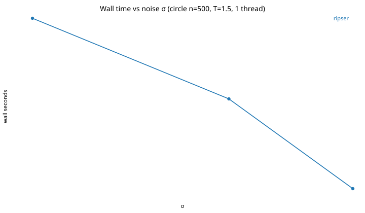

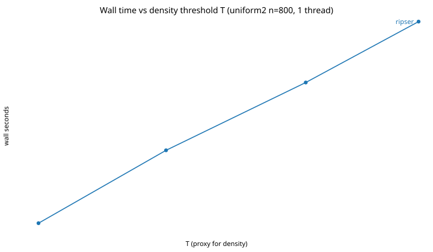

## How accurate is the scale path?

Essential topology on the measured families matches exact VR (two loops on a
figure-8, five on `many_loops`, one void on a sphere, three voids on
`multi_cavities`). Finite bars **do not** match VR.

| Family (\(n=300\)–\(400\)) | Exact vs Ripser | Scale unmatched | Scale bottleneck \(H_1\) | Scale \(W_1\) \(H_1\) | Notes |
| --- | --- | ---: | ---: | ---: | --- |
| figure8, circle, nested, many_loops | match | 0 | \(\sim 10^{-6}\) | \(\sim 10^{-6}\) | 2D loops ≈ VR |
| sphere | match | 52 | 0.024 | 0.21 | ess \(H_2=1\) kept |
| multi_cavities | match | 52 | 0.041 | — | ess \(H_2=3\) kept |
| mixed 1D/2D/3D | match (n=300 exact 33 ms) | 35 | 0.030 | — | exact-auto is RedZeD-cc; scale still cheaper |
| disconnected circles (held-out) | match | 0 | \(\sim 10^{-6}\) | \(\sim 10^{-6}\) | ess \(H_0=2,H_1=2\) |
| grid holes (post-freeze) | match | 0 | \(\sim 10^{-6}\) | \(\sim 10^{-6}\) | ess \(H_1=2\) |
| two spheres apart (post-freeze) | match | 45 | 0.028 | 0.21 | ess \(H_2=2\); \(W_1(H_2)=0.026\) |

GUDHI Alpha on the same clouds reports ess \(H_1=H_2=0\) and merges far
components into one \(H_0\). Sparse Rips kept essential 2D loops; it
failed / was slow on some 3D clouds. giotto-ph diagrams match Ripser
(6/6, including post-freeze families).

Persistence diagrams at \(n=400\) (filled = essential). Exact overlays Ripser.
Scale keeps the same essential bars on these 2D loops. Sparse keeps them
with extra finite bars. Alpha **drops** essential \(H_1\). On the sphere,
sparse \(H_2\) timed out and Alpha drops the void.


## Dispatcher: when it is right, and when it is wrong

`--estimate` and `--engine auto` share a 250-point residual / edge-fraction
probe. A **1-thread oracle** (run both exact engines):

| Suite | Recommended engine was faster | Misses |
| --- | ---: | --- |
| Phase-2 (incl. `heavy_noise_circle`) | 7 / 8 | thin → implicit; waste **2.1×** (11 vs 5 ms) |
| Phase-3 held-out / post-freeze | 5 / 9 | `disconnected_circles`, `nonuniform_circle` (thin → implicit, 1.3–1.6×); `two_spheres_apart` (hollow → RedZeD, **2.75×**, 16 vs 6 ms) |

`--mode auto` (exact vs scale vs sparse) matched the probe **8/8** then
**11/11** on `eval_mode_auto.py` (10 execute + 1 refuse on fat 4D \(H_2\):
`uniform4` \(n=250\), `maxdim=2`, probe names sparse, auto exits 3).
\(\tau\) was **not** retuned after the post-freeze misses — they cost
tens of milliseconds, not a change of regime. Mixed 1D/2D/3D at
`maxdim=2` is a **fat H2** residual, but the hang was forced
`--engine implicit` (tet enumeration); implicit now hands fat H2
(\(\lvert E\rvert>16n\) or \(\Delta>24\)) to RedZeD (mixed \(n=300\) 54 ms,
unmatched 0). Default exact-auto is RedZeD-cc
and finishes at \(n=300\) in 33 ms (Ripser 0.14 s). `--estimate` now
models cost on the largest T-component \(n_{cc}\) and recommends scale
when \(n_{cc}\ge 800\) or the flag is nearly complete
(`edge_frac≥0.5` and \(n_{cc}\ge 600\)). Held-out `ncc_auto.json`:
**0/11** timeout misses. Seed-17 `adversarial.json` (loops, bridges,
anisotropy, clusters, noise, degeneracy, multi-scale \(T\), mixed,
L1): **0/11** timeout misses, **0/8** exact-vs-Ripser mismatches.
Auto-dispatch probes from \(n\ge 64\).

A later high-d control (`uniform10`, \(d=10\), \(T=1.8\)) is outside the
frozen engine pack. Exact RedZeD stays cheap through \(n=8000\) (2.79 s).
Ripser and sparse first-timeout at \(n=4000\). The 250-point residual
band still marks exact *uncomfortable* (`exact_feasible=false`), but
`--mode auto` now **stays on exact** unless the sparse clock model is
clearly cheaper (live auto 0.74 s vs the old sparse 18 s). \(\tau\) stays
frozen. Fat \(H_2\) `uniform10` \(n=250\) still refuses (exit 3).
`--mode auto` held-out eval is **11/11** after that change.


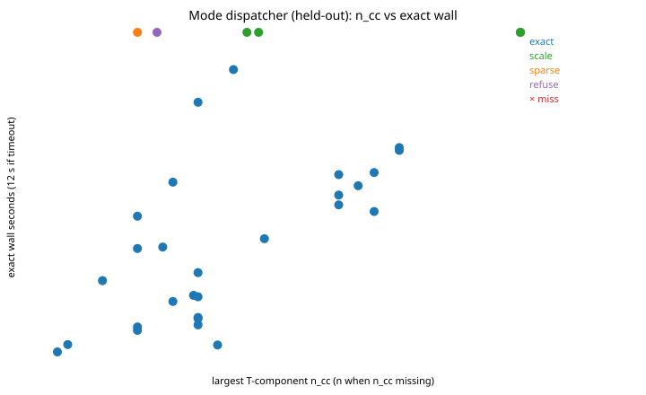

Claim-to-receipt map: [`benchmarks/results/consolidation/topology_claims.json`](benchmarks/results/consolidation/topology_claims.json)
(`nested_loops` sparse \(W_1(H_1)=1.05\), 52 unmatched, ess \(H_1=1\)).

Held-out high-d / L1 auto clock-compare (`highd_auto.json`): **0/8 wrong**.
Fat \(H_2\) refuse still holds on a new `uniform6` \(n=200\) cell.

Full numbers: [`benchmarks/results/consolidation/TABLES.md`](benchmarks/results/consolidation/TABLES.md).

## Limits (stated openly)

- Worst-case exact \(H_1\) on a **connected** dense \(G_T\) is still
  the same complexity class as Ripser (active leftover visits).
- Exact \(H_2\) on a **fat** residual leaves a 12 s budget near mixed
  \(n=2000\) (13.6 s measured). Forced `--engine implicit` used to hang
  at a few hundred points; it now hands fat H2 to RedZeD (~53 ms at
  mixed \(n=300\)). Use `--estimate` or `--mode scale` when \(n_{cc}\)
  is large or the flag is nearly complete.
- `--mode auto` **refuses** fat \(H_2\) sparse when \(d\notin\{2,3\}\)
  (exit 3, `auto_will_run=false`). That path hung at 25 s on 4D
  `uniform4` \(n=250\). Explicit `--mode sparse` still runs.
- `--estimate` is a probe plus conservative cutoffs. Runtime bands covered
  **48/48** scored walls after a 5 ms exact overhead, 25 ms hi-floor, the \(n_{cc}\) fat-H2 model, leftover-miss walls, and a 6× hi band on hollow leftover \(H_1\).
  It can still pick the slower exact engine (see `heavy_noise_circle`,
  `disconnected_circles`, `two_spheres_apart`).   On high-d `uniform10`
  \(n=4000\) it still marks exact uncomfortable, but `--mode auto` now
  stays on exact unless sparse is clearly cheaper.
- `--mode scale` requires Euclidean \(d\in\{2,3\}\) and is not a VR barcode.
- GUDHI Rips (explicit) times out by \(n\sim 10^3\) on these \(H_1\)
  clouds. GUDHI Alpha is fast and **not** a VR stand-in.
- giotto-ph 0.2.4 is an AGPL **oracle**, not a vendored engine. On this
  4-core box it tracks Ripser; 4 threads help \(H_2\) only.
- Dory (`pydory` 1.1.137) is a **1-thread oracle**, not vendored. It
  tracks Ripser on leftover \(H_1\) and loses on sphere \(H_2\) \(n=400\).
- Oineus (`oineus` 0.9.39) is a **1-thread oracle**, not vendored. It
  is slower than Ripser on leftover \(H_1\) and times out earlier
  than both Ripser and Dory.
- Dionysus 2.2.3 is a **1-thread oracle**, not vendored. Explicit VR
  is 65× slower than Ripser on circle \(n=400\) and times out earlier
  than Oineus.
- Coperto 0.1.7 is a **1-thread approximation oracle**, not vendored.
  Log-3 interleaving, not a VR barcode. Scale is faster and keeps
  essential 2D loops.
- Ripser++ was not built (no GPU).
- `--threads 1` is the fair comparison. Default PITH may use every core for
  a few scans; that is **not** where the 30–60× exact ratios come from.

## Layout

| Path | Role |
| --- | --- |
| `src/pith/` | Engine (C++17) |
| `docs/WHAT_WE_BUILT.md` | Contribution, exact vs approx |
| `docs/SCALE_PATH.md` | Euclidean alternative complex |
| `docs/COMPLEXITY.md` | Worst-case / regime / empirical |
| `docs/PRACTICAL_LIMITS.md` | How far each method goes on this box |
| `docs/REMAINING.md` | Spent exact-\(H_1\) levers vs remaining walls |
| `docs/GROWTH.md` | Fitted \(t\\approx Cn^p\) slopes (empirical) |
| `docs/SELECTED.md` | Living selected path (research) |
| `RESEARCH_LOG.md` | Iteration ledger |
| `third_party/ripser` | Unmodified Ripser `01add51` |
| `benchmarks/` | Stable suite (`benchmarks/README.md`); `run_wave*.py` is the research ledger |

## Reproduce

```sh
python3 benchmarks/generate_datasets.py --list
python3 benchmarks/test_cli_stable.py
python3 benchmarks/test_sparse_points.py
python3 benchmarks/test_baseline_hooks.py
python3 benchmarks/run_consolidation.py
python3 benchmarks/run_consolidation_limits.py
python3 benchmarks/eval_mode_auto.py
python3 benchmarks/eval_estimate.py
python3 benchmarks/eval_engine_auto.py
python3 benchmarks/reverify_headlines.py
python3 benchmarks/eval_wall_kind.py
python3 benchmarks/reverify_leftover_10x.py
python3 benchmarks/eval_leftover_ratio_n.py
python3 benchmarks/eval_leftover_heldout.py
python3 benchmarks/eval_leftover_miss_n.py
python3 benchmarks/eval_postfreeze.py
python3 benchmarks/run_axis_scaling.py
# optional oracle: pip install pydory  (not vendored; needs Python.h)
python3 benchmarks/reverify_dory.py
python3 benchmarks/run_dory_limits.py
# optional oracle: pip install oineus  (BSD wheel; not vendored)
python3 benchmarks/reverify_oineus.py
# optional oracle: pip install dionysus  (BSD wheel; not vendored)
python3 benchmarks/reverify_dionysus.py
# optional oracle: pip install coperto  (not vendored; not exact VR)
python3 benchmarks/reverify_coperto.py
python3 benchmarks/reverify_fat_h2.py
python3 benchmarks/run_uniform10.py
python3 benchmarks/eval_highd_auto.py
python3 benchmarks/eval_ncc_auto.py
python3 benchmarks/eval_adversarial.py
python3 benchmarks/run_stable.py
python3 benchmarks/collect_topology_claims.py
python3 benchmarks/run_baseline_pack.py
python3 benchmarks/run_sparse_limits.py
python3 benchmarks/run_sparse_scale.py
python3 benchmarks/fit_growth.py
python3 benchmarks/plot_consolidation.py
python3 benchmarks/plot_pd.py
```
