# PITH — practical persistent homology on CPUs

PITH computes **persistent homology** of a point cloud: which components,
loops, and voids appear and disappear as you thicken the cloud.

It is a **CPU tool**, not a GPU rewrite of Ripser. The gain comes from
choosing the right exact engine, avoiding a dense distance matrix when
the cloud is sparse, and — when exact Vietoris–Rips is no longer
practical — switching to a smaller Euclidean complex and saying so.

We did **not** invent a faster worst-case VR algorithm for every graph.
We **did** make everyday low-dimensional clouds usable at sizes where
stock VR engines time out.

Details: [`docs/WHAT_WE_BUILT.md`](docs/WHAT_WE_BUILT.md),
[`docs/SCALE_PATH.md`](docs/SCALE_PATH.md),
[`docs/COMPLEXITY.md`](docs/COMPLEXITY.md).

## What is this?

A **portfolio**: two exact VR engines, a small dispatcher that picks
between them, sparse graph representations when the threshold graph is
hollow, exact \(H_0\) on the 2D/3D Delaunay skeleton, and an optional
**different** Euclidean complex when exact VR becomes impractical.

## What did we improve?

| Kind | What |
| --- | --- |
| Exact VR, same barcode as Ripser | An **automatic engine**: collapse + implicit cohomology when the residual is thin; RedZeD (active enumeration) when it is not. Sparse \(G_T\) when the cloud is hollow. |
| Exact \(H_0\) in 2D/3D | Kruskal on the Delaunay 1-skeleton (the MST sits inside Delaunay). \(\Theta(n)\) edges instead of all pairs. |
| Large Euclidean clouds | `--mode scale`: flag of a Delaunay / local-radius graph. **Not** Vietoris–Rips. Essential loops and voids are kept on the tested families; finite bars differ. |
| Feasibility | `--estimate` guesses graph size, residual regime, and whether exact VR is reasonable. `--mode auto` follows that probe (default stays `--mode exact` so scripts do not silently change complex). |
| Fair timing | `--threads N` caps workers. Measured 1-thread vs hardware vs Ripser (always 1 thread). |

Internal experiment numbers live in [`RESEARCH_LOG.md`](RESEARCH_LOG.md),
not in the user interface.

## Is it exact?

**`--mode exact` (default)** is exact Vietoris–Rips up to the threshold \(T\).
On the hold suite the barcode matches Ripser (0 unmatched bars), including
a non-Euclidean L1 distance matrix.

**`--mode scale`** is a **different complex** (Delaunay-flag, optional
thicken). Compare essential Betti numbers and unmatched finite bars;
do not treat the diagram as VR.

**`--mode sparse`** is a Sheehy-style sparse Rips approximation (ε=0.6).
It **does** thin the flag (figure-8 \(n=400\): 5.6k edges vs 80k pairs;
\(n=8000\): 380k vs 32M). Euclidean point clouds no longer allocate an
n×n distance matrix; farthest-point insertion is still \(\Theta(n^2)\).
figure-8 \(n=8000\) is **0.65 s / 28 MB**; \(n=24000\) is **5.56 s / 101 MB /
ess \(H_1=2\)** (local \(p\approx 1.9\)–\(2.0\), the FPS wall). Scale on
the same \(n=24000\) cloud is **0.82 s**. Essential \(H_1\) is usually
kept; finite bars differ (8–52 unmatched) and a few families can add
extra essential loops (`nested_loops` \(n=400\): 4 vs VR 1). \(H_2\) is
slow (two spheres \(n=300\): 3.7 s) or times out (sphere \(n=400\);
4D fat \(H_2\)). Prefer `--mode scale` on Euclidean \(d\in\{2,3\}\).
`--mode auto` selects sparse on a held-out 4D cloud when exact VR is
marked impractical.

GUDHI **Alpha** is a third complex: on this suite it **drops** essential
\(H_1/H_2\) (loops and voids become 0). We do not use it as a VR stand-in.

## How to run

```sh
cmake -S src/pith -B src/pith/build -DCMAKE_CXX_COMPILER=g++
cmake --build src/pith/build -j
./src/pith/build/pith_test
```

```sh
# Exact VR (automatic engine)
./src/pith/build/pith --points cloud.csv --maxdim 1 --threshold 1.1

# Force one exact engine (benchmarking)
./src/pith/build/pith --points cloud.csv --mode exact --engine redzed --maxdim 1 --threshold 1.1

# Equal-thread comparison with Ripser
./src/pith/build/pith --points cloud.csv --threads 1 --mode exact --maxdim 1 --threshold 1.1

# Euclidean scale path (d = 2 or 3 only; not exact VR)
./src/pith/build/pith --points cloud.csv --mode scale --maxdim 1 --threshold 1.1
./src/pith/build/pith --points cloud.csv --mode scale --maxdim 2 --threshold 1.4

# Feasibility guess (no persistence)
./src/pith/build/pith --estimate --points cloud.csv --maxdim 1 --threshold 1.1 --format json

# Follow the probe: exact if feasible, else scale (d=2,3) or sparse
./src/pith/build/pith --points cloud.csv --mode auto --maxdim 2 --threshold 1.4
```

`--help` is the stable interface. `--help-experimental` lists research
flags kept for old scripts.

## When should I use each mode?

| Situation | Mode |
| --- | --- |
| You need the VR barcode (including finite bars) | `--mode exact` |
| You want the probe to choose exact / scale / sparse | `--mode auto` |
| Euclidean \(d\in\{2,3\}\), \(n\) in the tens of thousands, essential loops/voids | `--mode scale` |
| You only need \(H_0\) in 2D/3D | `--mode exact --maxdim 0` (Delaunay Kruskal) |
| Abstract / non-Euclidean distances | `--distances FILE --mode exact` |
| Fat residual and `maxdim≥2` (mixed 3D structure) | `--mode scale` if \(d\in\{2,3\}\); else lower \(T\) |
| Exact VR looks infeasible and \(d\ge 4\) | `--mode sparse` or a smaller \(T\); do not use scale |

## How much larger can it go?

On **this** hardware (4 CPUs, 16 GB, no GPU), under a **12 s** wall budget.
1-thread PITH vs 1-thread Ripser unless noted.

| Task | Ripser | giotto-ph t1 | giotto-ph t4 | GUDHI Rips | PITH exact (1 thr) | PITH scale |
| --- | --- | --- | --- | --- | --- | --- |
| Noisy circle \(H_1\), \(n=1000\) | 2.16 s | 2.47 s | 2.44 s | timeout | **0.068 s (32× / 36× giotto)** | not needed |
| Noisy circle \(H_1\), \(n=2000\) | timeout | — | — | — | 0.43 s (phase 2) | not needed |
| Figure-8 \(H_1\), \(n=2000\) | 2.51 s | 2.81 s | 2.78 s | timeout | **0.152 s (16×)** | 34 ms, ess \(H_1=2\) |
| Figure-8 \(H_1\), \(n=4000\) | timeout | — | — | — | **1.03 s** | 0.09 s, ess \(H_1=2\) |
| Figure-8 \(H_1\), \(n=24000\) | impractical | — | — | — | leftover wall | **0.79 s**, ess \(H_1=2\) |
| Sphere \(H_2\), \(n=400\) | 1.02 s | 1.12 s | 0.62 s | timeout | **0.017 s (60×; 36× vs giotto-4)** | 7 ms, ess \(H_2=1\) |
| Sphere \(H_2\), \(n=800\) | timeout | — | — | — | **0.057 s** | small |
| Sphere, \(n=80000\) | impractical | — | — | — | impractical as dense VR | **1.08 s**, ess \(H_2=1\) |
| Nested loops \(H_1\), \(n=2000\) | 6.44 s | — | — | — | **0.29 s** | 0.036 s |
| Blobs \(H_0\), \(n=25000\) | tens of seconds | — | — | — | **0.053 s** (Delaunay) | n/a |
| Mixed 1D/2D/3D, \(n=300\), `maxdim=2` | 0.13 s | — | — | — | **timeout** (fat H2) | **5 ms** |

The headline exact ratios **hold at 1 thread**, and they still hold against
**4-thread giotto-ph**. Hardware threads (4) change circle \(n=1000\) from
0.068 s to 0.069 s — not the source of the 32×. giotto-ph’s 4 threads help
sphere \(H_2\) (1.12→0.62 s) and do **not** speed up \(H_1\).

Pushed to the 12 s wall: circle \(n=2000\) PITH **0.34 s**, Ripser and
giotto timeout; figure-8 \(n=4000\) PITH **1.02 s**, giotto timeout;
sphere \(n=800\) PITH **0.058 s**, giotto timeout; nested loops \(n=2000\)
PITH **0.30 s** vs giotto **7.23 s** (24×).

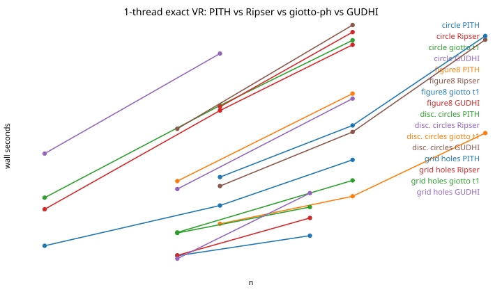

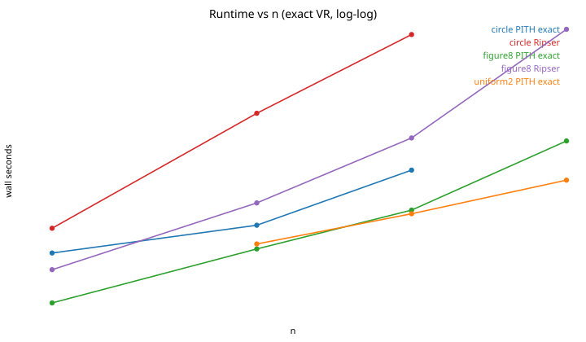

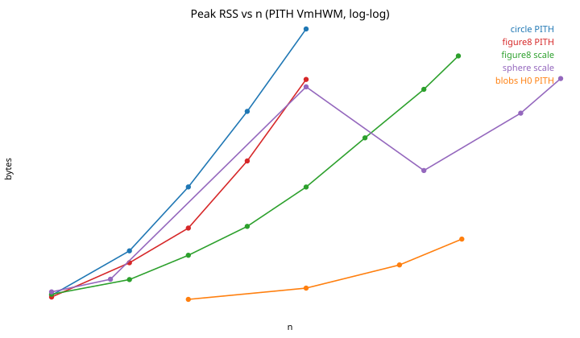

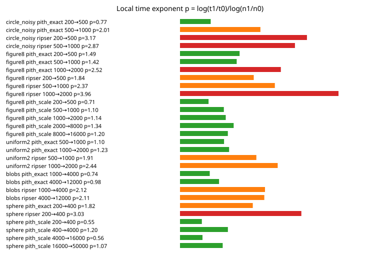

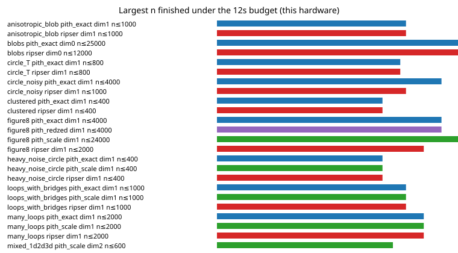

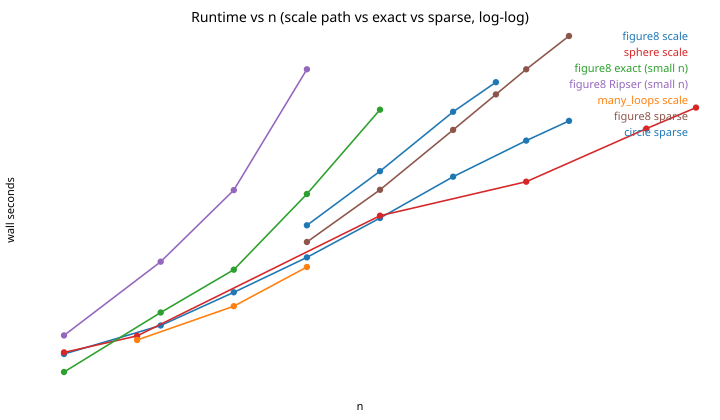

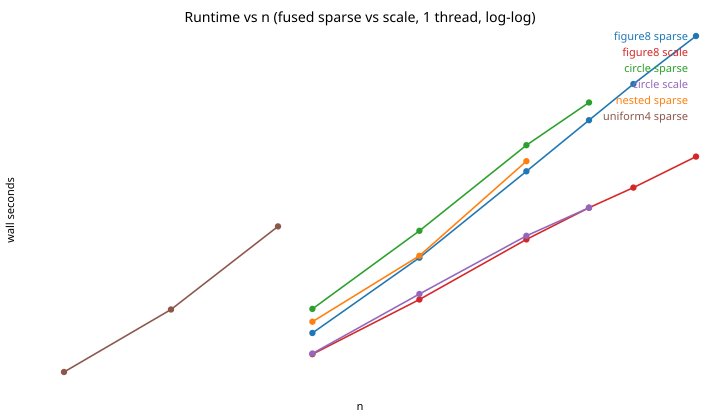

Local time exponents (empirical, not theorems): scale stays \(p\approx 1.0\)–\(1.3\);
exact figure-8 / nested-loop \(H_1\) leaves that regime around a few thousand
points (\(p\approx 2.8\)–\(3.0\)); Ripser on the same series is \(p\approx 2.7\)–\(3.5\).

## How accurate is the scale path?

Essential topology on the measured families matches exact VR (two loops on a
figure-8, five on `many_loops`, one void on a sphere, three voids on
`multi_cavities`). Finite bars **do not** match VR.

| Family (\(n=300\)–\(400\)) | Exact vs Ripser | Scale unmatched | Scale bottleneck \(H_1\) | Scale \(W_1\) \(H_1\) | Notes |
| --- | --- | ---: | ---: | ---: | --- |
| figure8, circle, nested, many_loops | match | 0 | \(\sim 10^{-6}\) | \(\sim 10^{-6}\) | 2D loops ≈ VR |
| sphere | match | 52 | 0.024 | 0.21 | ess \(H_2=1\) kept |
| multi_cavities | match | 52 | 0.041 | — | ess \(H_2=3\) kept |
| mixed 1D/2D/3D | exact timed out | 35 | 0.030 | — | `--mode auto` → scale |
| disconnected circles (held-out) | match | 0 | \(\sim 10^{-6}\) | \(\sim 10^{-6}\) | ess \(H_0=2,H_1=2\) |
| grid holes (post-freeze) | match | 0 | \(\sim 10^{-6}\) | \(\sim 10^{-6}\) | ess \(H_1=2\) |
| two spheres apart (post-freeze) | match | 45 | 0.028 | 0.21 | ess \(H_2=2\); \(W_1(H_2)=0.026\) |

GUDHI Alpha on the same clouds reports ess \(H_1=H_2=0\) and merges far
components into one \(H_0\). Sparse Rips kept essential 2D loops; it
failed / was slow on some 3D clouds. giotto-ph diagrams match Ripser
(6/6, including post-freeze families).

Persistence diagrams at \(n=400\) (filled = essential). Exact overlays Ripser.
Scale keeps the same essential bars on these 2D loops. Sparse keeps them
with extra finite bars. Alpha **drops** essential \(H_1\). On the sphere,
sparse \(H_2\) timed out and Alpha drops the void.

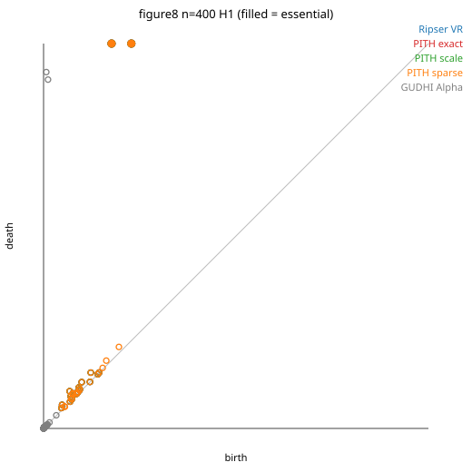
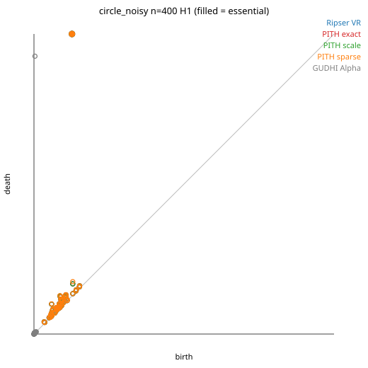
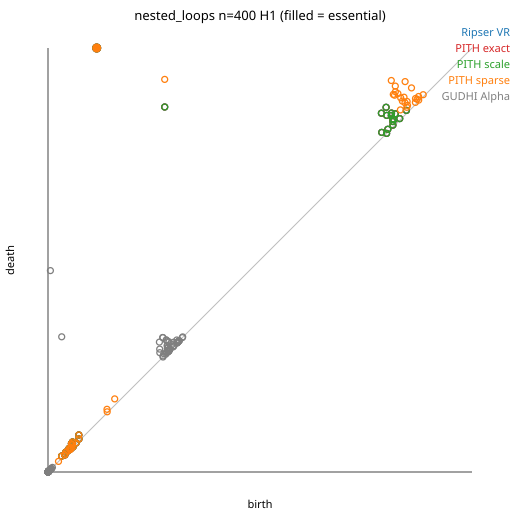
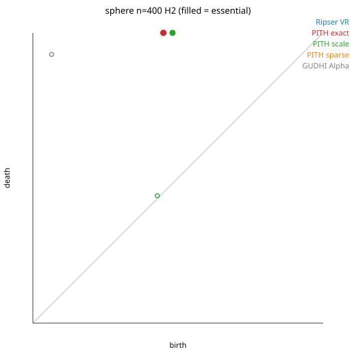

## Dispatcher: when it is right, and when it is wrong

`--estimate` and `--engine auto` share a 250-point residual / edge-fraction
probe. A **1-thread oracle** (run both exact engines):

| Suite | Recommended engine was faster | Misses |
| --- | ---: | --- |
| Phase-2 (incl. `heavy_noise_circle`) | 7 / 8 | thin → implicit; waste **2.1×** (11 vs 5 ms) |
| Phase-3 held-out / post-freeze | 5 / 9 | `disconnected_circles`, `nonuniform_circle` (thin → implicit, 1.3–1.6×); `two_spheres_apart` (hollow → RedZeD, **2.75×**, 16 vs 6 ms) |

`--mode auto` (exact vs scale vs sparse) matched the probe **8/8** then
**9/9** on the new families. \(\tau\) was **not** retuned after the
post-freeze misses — they cost tens of milliseconds, not a change of
regime. Mixed 1D/2D/3D at `maxdim=2` is a **fat H2** residual: exact
timed out at \(n=300\); `--estimate` marks exact infeasible and
recommends `--mode scale`. Auto-dispatch probes from \(n\ge 64\).

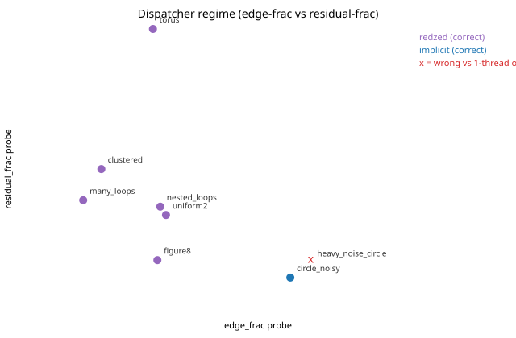

Full numbers: [`benchmarks/results/consolidation/TABLES.md`](benchmarks/results/consolidation/TABLES.md).

## Limits (stated openly)

- Worst-case exact \(H_1\) on a **connected** dense \(G_T\) is still
  the same complexity class as Ripser (active leftover visits).
- Exact \(H_2\) on a **fat** residual can time out at a few hundred points
  (mixed 1D/2D/3D). Use `--estimate` or `--mode scale`.
- `--estimate` is a probe plus conservative cutoffs. It can still pick the
  slower exact engine (see `heavy_noise_circle`, `disconnected_circles`,
  `two_spheres_apart`).
- `--mode scale` requires Euclidean \(d\in\{2,3\}\) and is not a VR barcode.
- GUDHI Rips (explicit) times out by \(n\sim 10^3\) on these \(H_1\)
  clouds. GUDHI Alpha is fast and **not** a VR stand-in.
- giotto-ph 0.2.4 is an AGPL **oracle**, not a vendored engine. On this
  4-core box it tracks Ripser; 4 threads help \(H_2\) only.
- Ripser++ was not built (no GPU).
- `--threads 1` is the fair comparison. Default PITH may use every core for
  a few scans; that is **not** where the 30–60× exact ratios come from.

## Layout

| Path | Role |
| --- | --- |
| `src/pith/` | Engine (C++17) |
| `docs/WHAT_WE_BUILT.md` | Contribution, exact vs approx |
| `docs/SCALE_PATH.md` | Euclidean alternative complex |
| `docs/COMPLEXITY.md` | Worst-case / regime / empirical |
| `docs/GROWTH.md` | Fitted \(t\\approx Cn^p\) slopes (empirical) |
| `docs/SELECTED.md` | Living selected path (research) |
| `RESEARCH_LOG.md` | Iteration ledger |
| `third_party/ripser` | Unmodified Ripser `01add51` |
| `benchmarks/` | Generators, consolidation runners, receipts |

## Reproduce

```sh
python3 benchmarks/generate_datasets.py --list
python3 benchmarks/test_cli_stable.py
python3 benchmarks/test_sparse_points.py
python3 benchmarks/test_baseline_hooks.py
python3 benchmarks/run_consolidation.py
python3 benchmarks/run_consolidation_limits.py
python3 benchmarks/eval_mode_auto.py
python3 benchmarks/run_baseline_pack.py
python3 benchmarks/run_sparse_limits.py
python3 benchmarks/run_sparse_scale.py
python3 benchmarks/fit_growth.py
python3 benchmarks/plot_consolidation.py
python3 benchmarks/plot_pd.py
```
